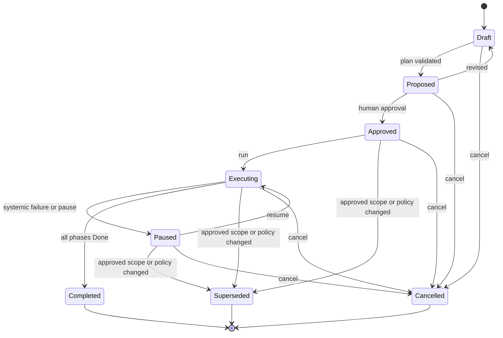
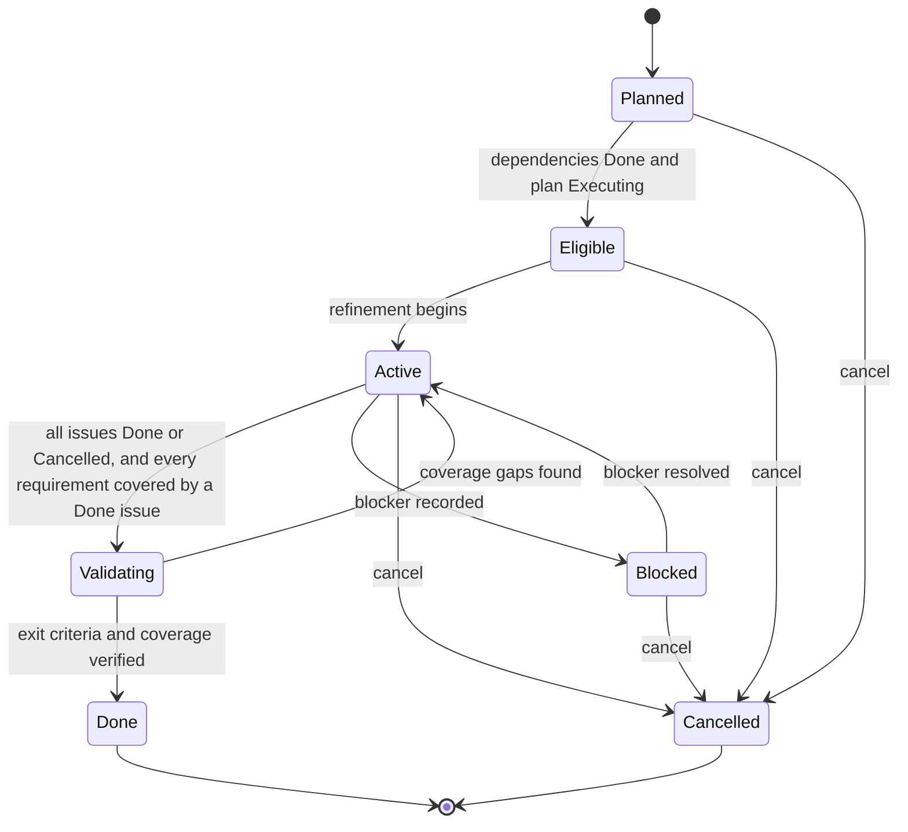
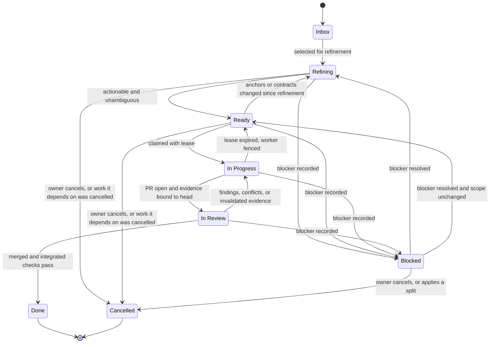
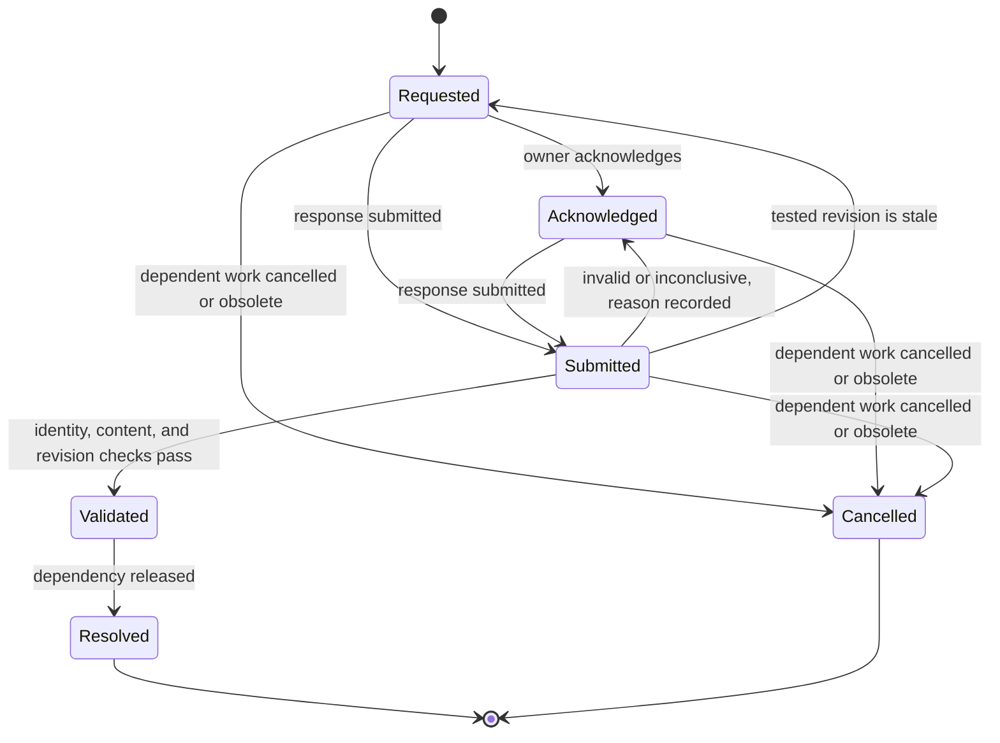
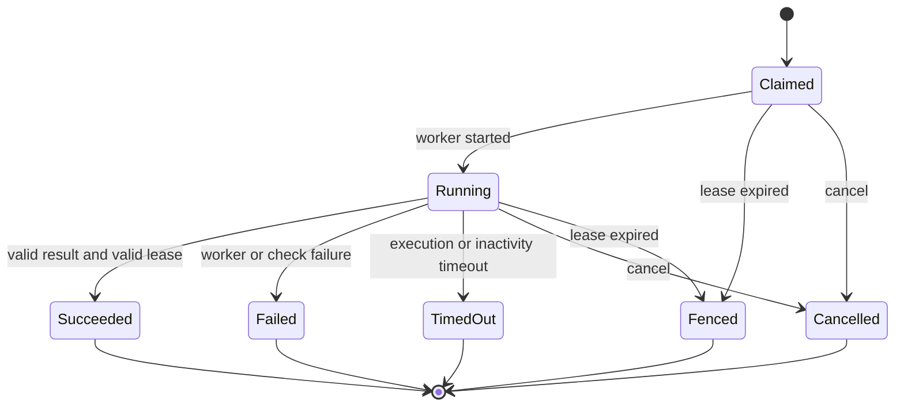

## Overview

The harness tracks five state machines. Only the trusted coordinator performs transitions. An agent request to change state is a proposal that the coordinator validates against the guards below.

Related documents: [harness specification](spec.md), [security model](security-model.md).

## Rules for All Machines

* Reject any transition not shown in the diagram, regardless of who requested it.
* Journal every transition with the actor, previous state, new state, and guard evidence.
* Make transitions idempotent. Replaying the same transition after a crash has no additional effect.
* Terminal states never transition again. Reopening work creates a new artifact that links to the old one.
* Record the previous state when entering `Blocked` or `Paused` so recovery returns to it.

## Plan

Guards:

* `Approved` requires a valid approval record whose digest matches the plan content and execution policy.
* `Executing` requires `Approved`, an isolation tier that permits `run`, and a verified approval digest at every scheduling pass.
* A change to approved outcomes, scope, or permissions supersedes the plan version. The revised version enters `Proposed` and needs approval of the delta only. Unaffected phases keep their authorization.

## Phase

Guards:

* `Done` requires every exit criterion verified and every requirement ID in the phase mapped to passing verification evidence.
* New in-scope issues found during validation return the phase to `Active`.

## Implementation Issue

Guards:

* `Ready` requires outcomes, requirement IDs, acceptance criteria, non-goals, code anchors, dependencies, contracts, and validation commands. Every dependency must be known. The base revision at refinement is recorded.
* `Ready` returns to `Refining` at claim time when the base moved and a code anchor or dependency contract changed since the recorded revision.
* `InProgress` requires a scheduler claim with a lease epoch and a clean isolated branch or worktree.
* `InReview` requires a PR plus focused and required check results bound to the current head revision, rerun on top of the current base.
* `InReview` returns to `InProgress` only while repair budget remains for the failure class. A clean rebase that keeps the patch identity unchanged keeps the review verdict, and any other change invalidates all evidence.
* `Done` requires a merge in dependency order, integrated checks passing, and review and test evidence that is not stale. An open PR or existing code never qualifies.
* External reconciliation may satisfy these guards only with PR, merge, CI, and review evidence fetched from GitHub and recorded with the operator identity. Missing review evidence is a blocker; agent evidence is never synthesized.
* `Blocked` requires an unmet dependency or an open human task. A budget-exhausted or policy-failed issue gets a decision task raised at the moment it blocks. Unrelated work continues.
* `Cancelled` is terminal. Cancelling an issue also cancels every issue that depends on it. An issue replaced by an owner-approved split is cancelled with `superseded_by` naming its parts, and its dependents are rewired to those parts. A phase left with requirements that no `Done` issue covers pauses the plan instead of validating.

## Human Task

Guards:

* `Validated` requires the responder's identity to match the owner or an authorized delegate, all required answers or artifacts present, and the response applicable to the current revision.
* `Resolved` records an outcome. For manual tests the outcome is `pass`, `fail`, or `inconclusive`. A `fail` outcome returns the dependent issue to `InProgress` for repair, and a new task covers the repaired revision. An `inconclusive` result returns to `Acknowledged` and never counts as passing.
* Reminders and escalations do not change state. Silence never moves a task forward.
* Worker-generated comments cannot cause any transition.

## Execution Attempt

Guards:

* `Claimed` grants a lease with a fresh epoch. Duplicate claims for the same issue are rejected across runner instances.
* `Succeeded` means the worker returned a schema-valid result under a valid lease. It does not mean the issue is done.
* `Fenced`, `TimedOut`, and `Failed` attempts carry a failure class (transient, deterministic, or policy) assigned by code from evidence. Transient failures consume the transient retry budget, deterministic failures consume the repair budget, and policy failures consume none and block the issue. The coordinator reconciles GitHub and branch state before scheduling a replacement attempt.
* A replacement attempt whose task-packet digest and model tier match a failed attempt is rejected.
* The broker rejects privileged writes from any attempt that is not `Claimed` or `Running` with the current epoch.

## Required Check Jobs

Checks are persisted coordinator jobs, not additional issue states.

* An implementer remains `Running` while its pre-review checks are pending. The scheduler renews its lease without polling the finished worker again. Rebase and integrated checks keep the issue `In Review`; phase checks keep the phase `Validating`.
* Every job records its tested head, base, unique ownership token, lease deadline, and container cleanup metadata. Results from a replaced or expired owner are fenced. A changed revision context discards results and triggers fresh validation.
* Graceful pause and cancellation with `--drain` wait for active check jobs, including jobs without worker claims. Immediate stops cancel named containers and remove their work directories.
* A check timeout records exit code 124. Commands have an in-container deadline as well as a coordinator timeout, so losing the runner cannot leave a command running indefinitely.
* After a restart, a new coordinator waits for unexpired ownership before cleaning up abandoned jobs and rerunning checks. A recorded merge resumes at integrated checks and is not merged again. Missing results never advance an issue or phase.
